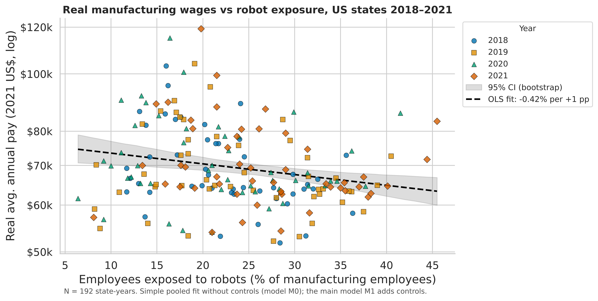
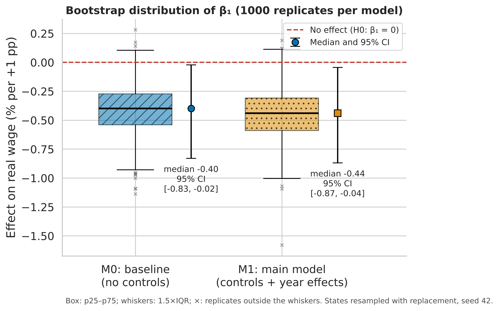
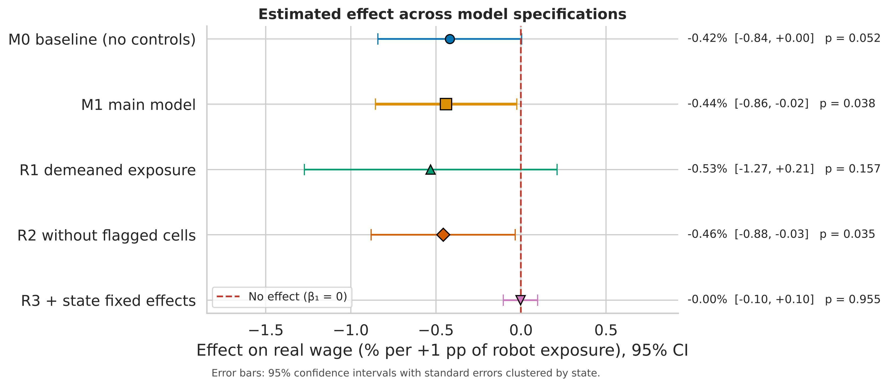

# Robotization and Wages in the US Manufacturing Industry

**Authors:** Nursultan Abukhanov ([@Homax06](https://github.com/Homax06)) · Aruna Zhakipova ([@zhakipovaaruna125-cpu](https://github.com/zhakipovaaruna125-cpu))

Course project, *Research Methods*. The full study design is in the [Methodology Passport Card](docs/Methodology_Card.pdf); the formal model is in [docs/domain_model.md](docs/domain_model.md); every number below is reproduced in [notebooks/01_data_analysis.ipynb](notebooks/01_data_analysis.ipynb).

## Overview

**Research question.** Is a higher share of manufacturing employees exposed to industrial robots in a US state associated with a different level of real wages in that state's manufacturing sector?

**Design.** Quantitative observational study on a state × year panel, 2018–2021, NAICS 31–33 (manufacturing), private ownership, 49 states.

| | |
|---|---|
| Exposure (X) | Percent of employees exposed to robots, by state (Census Bureau, Annual Survey of Manufactures, ASM) |
| Outcome (Y) | ln(real average annual pay), by state (BLS QCEW; deflated with CPI-U, base year 2021) |
| Controls | ln(employment), ln(establishments), year effects |
| Estimator | OLS, standard errors clustered by state; cluster bootstrap (1,000 replicates after 20 warm-up) for a second 95% CI |
| Hypotheses | H0: β₁ = 0 · H1: β₁ ≠ 0 (two-sided, α = 0.05) |

The coefficient β₁ × 100 is read as the percent change in real wages per +1 percentage point (pp) of robot exposure. The result is an **association**, not proof of causation.

## Results & Discussion

### Descriptive statistics (state × year panel, N = 195; 192 with robot exposure)

| Variable | Mean ± SD | Median (p25–p75) |
|---|---|---|
| Robot exposure, % of employees | 23.5 ± 8.3 | 22.8 (17.4–29.6) |
| Real average annual pay, 2021 US$ | 70,111 ± 11,836 | 66,087 (63,224–76,859) |
| Manufacturing employment, persons | 255,084 ± 249,300 | 177,610 (67,746–353,017) |

### Main result: Baseline (M0) vs Main model (M1)

| Model | β₁ | % change in real wage per +1 pp | Cluster-robust 95% CI, % | Bootstrap 95% CI, % | p-value | Adj. R² | Bootstrap error rate |
|---|---|---|---|---|---|---|---|
| M0, no controls (baseline) | −0.0042 | −0.42 | [−0.84, +0.00] | [−0.83, −0.02] | 0.052 | 0.044 | 0% |
| **M1, controls + year effects** | **−0.0044** | **−0.44** | **[−0.86, −0.02]** | **[−0.87, −0.04]** | **0.038** | **0.320** | **0%** |

**Decision: H0 is rejected at α = 0.05 in the main model M1.**

Bootstrap distribution of the effect, % per pp, Median (p25–p75): M0 −0.40 (−0.54 to −0.27), M1 −0.44 (−0.59 to −0.31); Mean ± SD: M0 −0.41 ± 0.21, M1 −0.45 ± 0.22. In 98% of the replicates the effect is below zero. Benchmark of one model fit, ms, Median (p25–p75) / p95 / p99: M0 3.05 (2.85–3.34) / 4.47 / 5.05, M1 4.22 (3.95–4.61) / 6.16 / 7.18.

### Robustness checks

| Model | Change vs M1 | % change per +1 pp | 95% CI, % | p-value | Same sign as M1? |
|---|---|---|---|---|---|
| R1 | demeaned (industry-composition-adjusted) exposure | −0.53 | [−1.27, +0.21] | 0.157 | yes (not significant) |
| R2 | cells flagged "(s)" removed | −0.46 | [−0.88, −0.03] | 0.035 | yes |
| R3 | state fixed effects added | −0.00 | [−0.10, +0.10] | 0.955 | no effect |

### Guardrails

| Check | Value | Criterion | Status |
|---|---|---|---|
| VIF (max) | 16.5 (robot exposure: 1.55) | < 10 | FLAG: caused by the two size controls (correlation 0.95), not by robot exposure |
| Breusch–Pagan p-value | < 0.001 | > 0.05 | FLAG: heteroskedasticity, handled by cluster-robust SE |
| Jarque–Bera p-value | 0.082 | > 0.05 | PASS |
| Min states per year | 47 | ≥ 45 | PASS |
| Share of withheld robot cells | 1.5% | ≤ 10% | PASS |
| Bootstrap error rate (M0, M1) | 0% | ≤ 5% | PASS |
| Two runs identical | identical | identical | PASS |

### Figures



**Figure 1.** Real average annual pay (2021 US$, log scale) against the share of employees exposed to robots, by state and year. Dashed line: pooled OLS fit with 95% bootstrap confidence band.



**Figure 2.** Distribution of the effect over 1,000 cluster-bootstrap replicates for M0 and M1, with the median and its 95% CI. Dashed red line: no effect.



**Figure 3.** Estimated effect with 95% confidence intervals for all model specifications.

Vector versions (PDF) are in [reports/figures/](reports/figures/).

### Discussion

In the main model (M1), states where a larger share of manufacturing employees works with industrial robots pay lower real wages: one additional percentage point of robot exposure is associated with about 0.44% lower real average annual pay (p = 0.038), so the null hypothesis of no association is rejected. The cluster-robust and the bootstrap confidence intervals agree and both lie below zero, although the upper bound is close to zero, so the effect is small and estimated with limited precision. Adding the size controls and year effects barely changes the coefficient compared with the baseline M0 (−0.42% vs −0.44%) but makes it significant, and removing unreliable Census cells (R2) gives the same result. Two checks qualify the finding: with industry-composition-adjusted exposure (R1) the sign is the same but the interval includes zero, and with state fixed effects (R3) the effect disappears. This means the association is a difference between states rather than a change within a state over time; robot exposure moved very little over four years, and stable state characteristics (industry mix, cost of living, unionization) may drive both robot adoption and wages. The study is observational, covers a short panel, and relies on an experimental Census data product, so the result should be read as an association, not as a causal effect of robots on wages.

## Domain model

The regression equations, OLS loss function, target metrics and notation table are in [docs/domain_model.md](docs/domain_model.md).

## Repository structure

```
.
├── README.md
├── LICENSE                     MIT
├── config.yaml                 all parameters: years, sector, paths, model, guardrails, bootstrap, seed
├── requirements.txt            exact package versions (Python 3.13)
├── Dockerfile                  reproducible environment
├── pytest.ini
├── src/
│   ├── main.py                 regression pipeline: python -m src.main
│   ├── load_data.py            reads/cleans ASM robots, QCEW wages, CPI; builds the panel
│   ├── analysis.py             models M0, M1, R1–R3 and guardrail diagnostics
│   ├── collector.py            cluster bootstrap with warm-up, JSONL logging, error tracking
│   ├── process_data.py         warm-up filtering, error rate, outlier flags, statistical aggregation
│   ├── visualize.py            publication-ready figures
│   ├── config.py               config loading, SHA-256 hashing of inputs
│   └── states.py               state names ↔ FIPS codes
├── tests/                      unit and integration tests (python -m pytest)
├── data/
│   ├── sample/                 micro-files (10 rows each) for the smoke test
│   ├── raw/                    full Census/BLS data NOT in Git, except the bootstrap log:
│   │   ├── test_run.jsonl      2,040 records: warm-up and benchmark replicates of M0 and M1
│   │   └── test_run_meta.json  hardware, software, seed and input hashes of that run
│   └── processed/
│       ├── panel.csv           state × year panel used by the regressions
│       ├── metrics_summary.csv cleaned and aggregated bootstrap metrics
│       ├── descriptive_stats.csv
│       └── benchmark_clean.csv benchmark records with outlier flags
├── notebooks/
│   └── 01_data_analysis.ipynb  full analysis, executed top to bottom
├── reports/figures/            fig1–fig3 as .pdf (vector) and .png (300 DPI)
└── docs/
    ├── Methodology_Card.pdf
    └── domain_model.md
```

## System requirements

- Python **3.13** (or Docker)
- ~500 MB disk for packages; no GPU
- Internet only to install packages or to download the full data

## Quickstart

Option A, Docker (nothing else to install):

```bash
docker build -t robots-wages .
docker run --rm -v "$(pwd)/results:/app/results" robots-wages
```

Option B, plain Python:

```bash
python -m venv .venv && source .venv/bin/activate   # Windows: .venv\Scripts\activate
pip install -r requirements.txt
python -m pytest
```

### Reproduce the results

From the committed files (no download needed):

```bash
python -m src.process_data     # -> data/processed/metrics_summary.csv
python -m src.visualize        # -> reports/figures/
```

or open `notebooks/01_data_analysis.ipynb` and run *Kernel → Restart & Run All*.

From the raw data:

1. Download the files listed in [data/README.md](data/README.md) into `data/raw/`.
2. Run:

```bash
python -m src.main --config config.yaml --mode full        # regression models + guardrails -> results/
python -m src.collector --config config.yaml --mode full   # bootstrap log -> data/raw/test_run.jsonl
python -m src.process_data
python -m src.visualize
```

Without `--mode full`, `main` and `collector` run on the synthetic sample (smoke test only; the numbers mean nothing).

## Reproducibility

Fixed seed (42) for the bootstrap and the notebook; exact package pins; `test_run_meta.json` and the run log record Python and package versions, CPU, RAM, OS and SHA-256 of every input file; the regression pipeline computes everything twice and checks that the result tables are identical.

## Data sources

- U.S. Census Bureau, Annual Survey of Manufactures: Robotic Equipment tables (experimental data product).
- U.S. Bureau of Labor Statistics, Quarterly Census of Employment and Wages (QCEW), annual averages.
- U.S. Bureau of Labor Statistics, Consumer Price Index for All Urban Consumers (CPI-U).

## Citation

```bibtex
@misc{abukhanov_zhakipova_2026_robotization,
  author = {Abukhanov, Nursultan and Zhakipova, Aruna},
  title  = {Robotization and Wages in the {US} Manufacturing Industry},
  year   = {2026},
  howpublished = {\url{https://github.com/Homax06/robotization-wages-us-manufacturing}},
  note   = {Course project, Research Methods}
}
```

## License

[MIT](LICENSE) © 2026 Nursultan Abukhanov and Aruna Zhakipova
