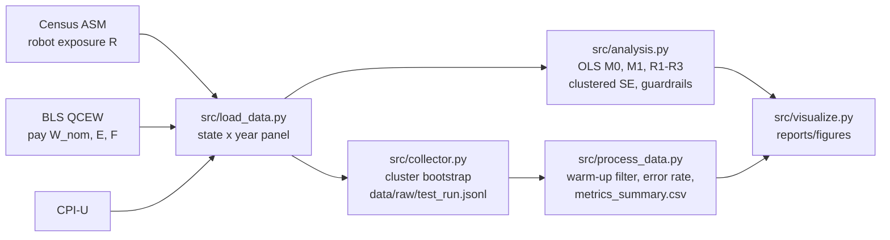

# Domain Model: Formal Specification

This document formalizes the statistical model behind the study *Robotization and Wages in the US Manufacturing Industry*:
the estimating equation, the loss function that is minimized, the target metrics and the full notation.
It follows the ML / quantitative track of the Task 3 brief (LaTeX definition of the loss function, target metrics and a notation table).

## 1. Unit of observation

A US state $i$ in a year $t$, manufacturing sector (NAICS 31–33), private ownership.

$$
i \in \{1, \dots, N\}, \quad N = 49 \text{ states}, \qquad t \in \{2018, 2019, 2020, 2021\}, \qquad n = 192 \text{ state-years in the main sample.}
$$

## 2. Estimating equations

**Main model (M1).** Log real wage on robot exposure, two size controls and year effects:

$$
\ln(W_{it}) = \beta_0 + \beta_1 R_{it} + \gamma_1 \ln(E_{it}) + \gamma_2 \ln(F_{it}) + \sum_{s=2019}^{2021} \tau_s \, \mathbb{1}[t = s] + \varepsilon_{it}
$$

**Baseline (M0).** The same equation without controls and year effects:

$$
\ln(W_{it}) = \beta_0 + \beta_1 R_{it} + \varepsilon_{it}
$$

**Robustness checks.** R1 replaces $R_{it}$ with the industry-composition-adjusted (demeaned) exposure $\tilde{R}_{it}$;
R2 re-estimates M1 without cells the Census Bureau flags as unreliable "(s)";
R3 adds state fixed effects $\alpha_i$ to M1.

**Real wage.** Nominal pay is deflated to 2021 dollars with the CPI-U:

$$
W_{it} = W^{\text{nom}}_{it} \cdot \frac{\text{CPI}_{2021}}{\text{CPI}_t}
$$

**Interpretation of $\beta_1$.** Because the outcome is in logs and exposure is in percentage points,

$$
\%\Delta W \approx 100 \cdot \beta_1 \quad \text{per } +1 \text{ percentage point of } R_{it}.
$$

## 3. Loss function

The coefficients are estimated by ordinary least squares, i.e. by minimizing the sum of squared residuals:

$$
\mathcal{L}(\boldsymbol{\theta}) = \sum_{i=1}^{N} \sum_{t} \left( \ln W_{it} - \mathbf{x}_{it}^{\top} \boldsymbol{\theta} \right)^2,
\qquad
\hat{\boldsymbol{\theta}} = \arg\min_{\boldsymbol{\theta}} \mathcal{L}(\boldsymbol{\theta}) = (\mathbf{X}^{\top}\mathbf{X})^{-1}\mathbf{X}^{\top}\mathbf{y}
$$

where $\mathbf{x}_{it} = (1, R_{it}, \ln E_{it}, \ln F_{it}, \mathbb{1}[t=2019], \mathbb{1}[t=2020], \mathbb{1}[t=2021])^{\top}$
and $\boldsymbol{\theta} = (\beta_0, \beta_1, \gamma_1, \gamma_2, \tau_{2019}, \tau_{2020}, \tau_{2021})^{\top}$.

**Uncertainty (cluster-robust variance).** Observations of the same state are correlated over time, so the variance of
$\hat{\boldsymbol{\theta}}$ is clustered by state $g$:

$$
\widehat{V}(\hat{\boldsymbol{\theta}}) = (\mathbf{X}^{\top}\mathbf{X})^{-1}
\left( \sum_{g=1}^{N} \mathbf{X}_g^{\top} \hat{\mathbf{u}}_g \hat{\mathbf{u}}_g^{\top} \mathbf{X}_g \right)
(\mathbf{X}^{\top}\mathbf{X})^{-1}
$$

**Cluster bootstrap.** For $b = 1, \dots, B$ ($B = 1000$, after 20 warm-up replicates, seed 42) draw $N$ states with replacement,
re-estimate the model and store $\hat{\beta}_1^{(b)}$. The bootstrap 95% CI is

$$
\text{CI}_{95\%}^{\text{boot}} = \left[ \hat{q}_{0.025}\big(\hat{\beta}_1^{(b)}\big),\; \hat{q}_{0.975}\big(\hat{\beta}_1^{(b)}\big) \right].
$$

## 4. Hypotheses and target metrics

$$
H_0: \beta_1 = 0 \qquad H_1: \beta_1 \neq 0 \qquad (\alpha = 0.05,\ \text{two-sided})
$$

$$
t = \frac{\hat{\beta}_1}{\widehat{\text{SE}}(\hat{\beta}_1)}, \qquad
p = 2\,\Pr\!\left(T_{N-1} > |t|\right), \qquad
\text{reject } H_0 \iff p < \alpha
$$

| Role | Metric | Definition |
|---|---|---|
| Primary | $\hat{\beta}_1$ with 95% CI and $p$-value (M1) | effect of exposure; decision on $H_0$ |
| Primary (robustness of uncertainty) | Bootstrap 95% CI of $\hat{\beta}_1$ | $[\hat{q}_{0.025}, \hat{q}_{0.975}]$ over $B$ replicates |
| Secondary | Adjusted $R^2$ | $1 - (1 - R^2)\dfrac{n-1}{n-k-1}$ |
| Secondary | RMSE | $\sqrt{\tfrac{1}{n}\sum_{i,t} \hat{\varepsilon}_{it}^{\,2}}$ |
| Guardrail | VIF | $\text{VIF}_j = 1 / (1 - R_j^2) < 10$ |
| Guardrail | Breusch–Pagan $p$ | $> 0.05$ (otherwise rely on cluster-robust SE) |
| Guardrail | Jarque–Bera $p$ | $> 0.05$ |
| Guardrail | Coverage | $\ge 45$ states per year; $\le 10\%$ withheld robot cells |
| Guardrail | Bootstrap error rate | $\dfrac{\#\{b : \text{fit failed}\}}{B} \le 5\%$ |
| Guardrail | Reproducibility | two runs give identical result tables |
| Baseline | M0 vs M1 | same sample, with and without controls |

## 5. Notation

| Symbol | Meaning | Unit / domain | Source |
|---|---|---|---|
| $i$ | state | 49 states (DC and Hawaii excluded: most cells withheld) | — |
| $t$ | year | 2018–2021 | — |
| $W_{it}$ | real average annual pay, manufacturing | 2021 US\$ | BLS QCEW, CPI-U |
| $W^{\text{nom}}_{it}$ | nominal average annual pay | US\$ | BLS QCEW |
| $\text{CPI}_t$ | CPI-U, all items, U.S. city average, annual average | index, 1982–84 = 100 | BLS |
| $R_{it}$ | employees exposed to robots | % of manufacturing employees (pp) | Census ASM, Robotics tables |
| $\tilde{R}_{it}$ | demeaned (industry-composition-adjusted) exposure | pp | Census ASM |
| $E_{it}$ | manufacturing employment | persons | BLS QCEW |
| $F_{it}$ | manufacturing establishments | count | BLS QCEW |
| $\tau_s$ | year effect for year $s$ (2018 = reference) | log points | — |
| $\alpha_i$ | state fixed effect (R3 only) | log points | — |
| $\beta_0$ | intercept | log points | — |
| $\beta_1$ | **coefficient of interest** | log points per pp | — |
| $\gamma_1, \gamma_2$ | coefficients on the size controls | elasticities | — |
| $\varepsilon_{it}$ | error term | log points | — |
| $\boldsymbol{\theta}$ | vector of all coefficients | — | — |
| $\mathcal{L}$ | OLS loss (sum of squared residuals) | log points² | — |
| $B$ | number of bootstrap replicates | 1000 (+20 warm-up) | `config.yaml` |
| $\alpha$ | significance level | 0.05 | `config.yaml` |

## 6. Pipeline: where each quantity is computed

